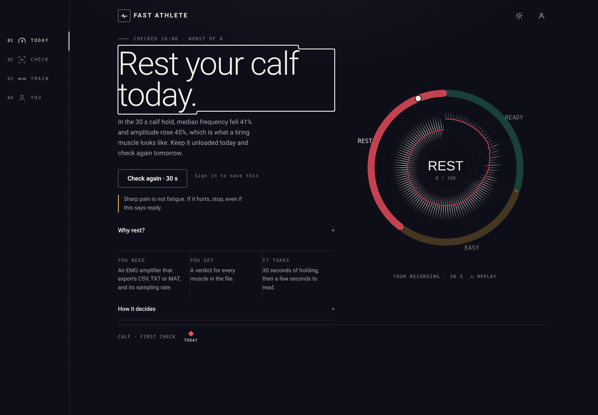

# FAST Athlete

FAST Athlete reads a surface EMG recording and says what to do with the muscle
today: train it, go easy on it, or rest it.



FAST Athlete is a research prototype. The thresholds are provisional and it is
not a diagnostic device.

A running copy is at <https://fast.ptrehab.icu>.

## What it does

You hold a contraction for thirty seconds while an EMG amplifier records. You
upload the file and say which muscle each channel is. The app measures how the
signal changed between the start of the hold and the end, and scores it.

- **Ready** means neither measure moved far enough to call fatigue. Train as
  planned.
- **Go easy** means both moved a little. Fewer sets today.
- **Rest** means both moved a lot. Leave the muscle unloaded and check again
  tomorrow.

The advice also takes your saved checks into account, so a muscle that has read
the same or worse for several days is told to rest longer.

## Quick start

```bash
git clone https://github.com/Halhousni/fast-athlete
cd fast-athlete
docker compose -f app/docker-compose.yml up --build
```

Open <http://127.0.0.1:8501>. The bundled `app/demo_recording.csv` is a synthetic
eight-channel recording with a known answer, so you can try the whole flow
without an amplifier. Its sampling rate is 1000 Hz.

Without Docker:

```bash
python3 -m venv .venv
. .venv/bin/activate
pip install -r app/requirements.txt pytest

cd app
FAST_DATA_DIR=/tmp/fast-data python3 -m uvicorn app:app --port 8501
```

## How it measures

Each channel is resampled to 200 Hz, split into 34 overlapping bands, and each
band gets its own synchrosqueezed transform. The band powers are summed onto one
grid. Median frequency and RMS are then tracked through the recording, and the
last five seconds are compared with the first five.

Fatigue shows up as a fall in median frequency and a rise in RMS. Both count, so
a frequency drop with no amplitude change is half the evidence and scores
accordingly. The full method, including the thresholds and what they mean, is in
[docs/method.md](docs/method.md).

The method follows Zhao, Charoonsrisawad, Ichiyama and Chakrabarty (2025).

## Accounts

You can use the app without one. An account only exists to keep your checks, so
the advice can compare this week with the last.

An account is a username and a password, stored on the server that runs the app.
Nothing is sent anywhere else, and no one can browse the list of accounts. To
leave, delete the account from the You screen; it asks for your password and
removes your saved checks with it.

There is no email on the server, so a forgotten password is reset by whoever
runs it:

```bash
docker compose exec signal-analyzer python3 store.py passwd <username>
```

## Running it

`app/docker-compose.yml` builds one container, publishes it on loopback by
default, and keeps the database on a volume.

| variable | default | what it does |
|---|---|---|
| `FAST_BIND_IP` | `127.0.0.1` | address the container publishes on |
| `FAST_COOKIE_SECURE` | `0` | set to 1 behind TLS |
| `FAST_DATA_DIR` | `/data` | where `fast.db` lives |
| `FAST_BUILD` | `local` | commit stamped into the image |
| `FAST_FA_WORKERS` | `6` | threads for the band transforms |

The port is bound to loopback on purpose. Docker's published ports bypass UFW,
so binding every interface puts the app on the internet around whatever proxy
terminates TLS.

Uploads are held in memory and expire after thirty minutes; only a saved check
is written to the database. One analysis takes about half a minute for eight
channels, and the app runs two at a time.

## Development

```
app/app.py            HTTP routes, page, security headers
app/engine.py         the measurement
app/ingest.py         CSV, TXT and MAT parsing, sampling rate, channel matching
app/store.py          SQLite accounts, results, sessions
app/version.py        what is running
app/static/           app.css, app.js, theme.js, icon.svg, vendor/musclemap
app/templates/        index.html
docs/method.md        the measurement in full
scripts/              regenerating the demo data and the spectrogram strip
tests/                pytest
```

```bash
python3 -m pytest tests -q
```

The running version is at `/healthz` and at the foot of the You screen.

## Limits

- The thresholds are provisional and are being validated.
- A result compares one muscle with itself, within one recording. Electrode
  placement matters more than anything else you do.
- Sharp pain is not fatigue. If it hurts, stop.
- Nothing here replaces a clinician.

## Licence

MIT. See [LICENSE](LICENSE). Third-party notices are in
[THIRD_PARTY_NOTICES.md](THIRD_PARTY_NOTICES.md).
